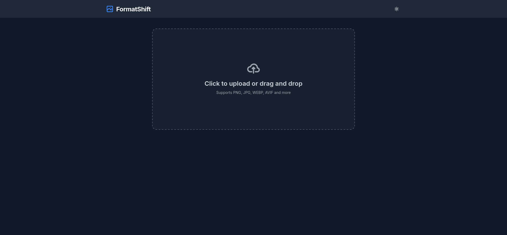
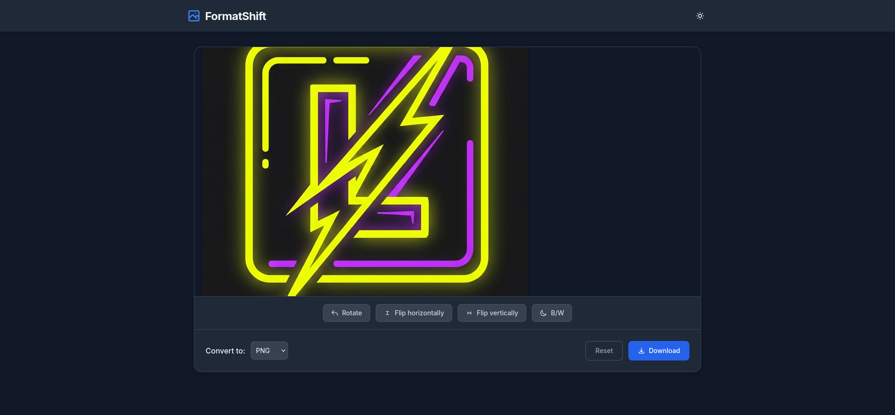
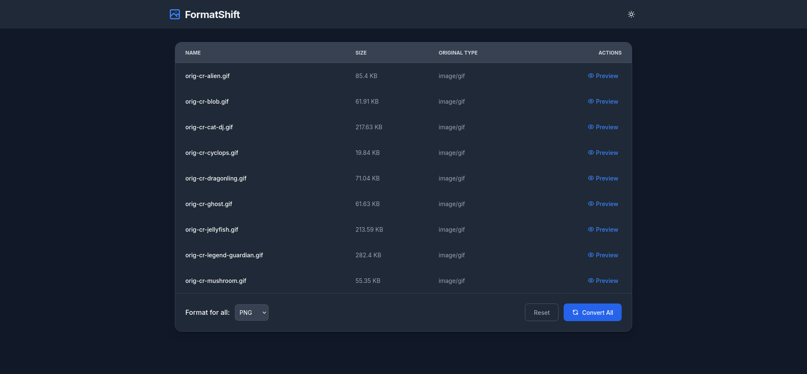
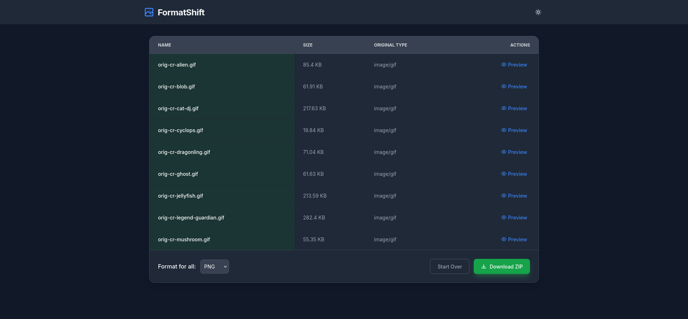

<h1>🖼️ FormatShift 🔄</h1>

A modern, privacy-first, client-side web app to instantly convert and edit images. Featuring drag-and-drop, batch processing, visual editing tools, and native browser conversion without any server uploads.

  <a href="http://paypal.me/R0mb0">
    <picture>
      <source media="(prefers-color-scheme: dark)" srcset="https://github.com/R0mb0/Support_the_dev_badge/blob/main/Badge/SVG/Support_the_dev_badge_Dark.svg">
      <source media="(prefers-color-scheme: light)" srcset="https://github.com/R0mb0/Support_the_dev_badge/blob/main/Badge/SVG/Support_the_dev_badge_Light.svg">
      
    </picture>
  </a>

---

<h2><a href="https://r0mb0.github.io/FormatShift/">👉 Click here to test the app! 👈</a></h2>

<h2>🚀 Features</h2>
<ul>
<li><strong>Local Processing</strong>: The core image conversion happens entirely in your browser using HTML5 Canvas. Your images are never uploaded to a server!</li>
<li><strong>Batch Processing</strong>: Convert multiple images simultaneously and download them all neatly packed into a single ZIP file.</li>
<li><strong>Quick Editing Tools</strong>: When processing a single image, easily rotate, flip horizontally/vertically, or apply a grayscale filter before converting.</li>
<li><strong>Modern Format Support</strong>: Export your files into a variety of formats including PNG, JPG, WEBP, AVIF, GIF, and BMP.</li>
<li><strong>Modern UI</strong>: Fast, responsive, and adaptive Dark/Light mode interface based on your system preferences, with manual override controls.</li>
<li><strong>100% Offline Capable</strong>: Designed to run entirely on your local machine with zero external dependencies when assets are downloaded.</li>
</ul>

<h2>🛠️ How it works</h2>
<ol>
<li><strong>Drag and drop</strong> your image file(s) into the dropzone (or click to browse).</li>
<li>If you uploaded a single image, use the toolbar to preview edits like rotation or grayscale.</li>
<li>If you uploaded multiple images, review the batch list and select your desired output format for all files.</li>
<li>The app uses your browser's native Canvas API to redraw and encode the images into the newly selected format.</li>
<li>Download your converted image instantly, or grab the ZIP file for batch conversions!</li>
</ol>

<h2>🏆 What makes it special?</h2>
<ul>
<li><strong>100% Client-Side Architecture</strong>: Everything runs locally on your device. No backend logic, no server costs, and ultimate privacy.</li>
<li><strong>No Server Bottlenecks</strong>: Conversion speed is based entirely on your own device's hardware, meaning no waiting in queues or uploading huge files over slow internet connections.</li>
</ul>

<h2>💡 Why use this tool?</h2>
<ul>
<li><strong>Format Compatibility</strong>: Quickly convert annoying formats (like WEBP or AVIF downloaded from the web) into standard JPGs or PNGs without installing heavy desktop software.</li>
<li><strong>Absolute Privacy</strong>: Safely convert sensitive documents, personal photos, or private screenshots knowing they will never leave your computer.</li>
</ul>

<h2>⚡ Getting Started</h2>

<h3>Online</h3>

Simply visit the <a href="https://r0mb0.github.io/Format_shift/">Live Demo hosted on GitHub Pages</a>.

<h3>Local Installation</h3>

Running this tool locally is ridiculously easy:

<ol>
<li><strong>Clone this repository</strong> or simply download the source files.</li>
<li>Double-click <code>index.html</code> to open it in your favorite browser.</li>
<li>Done. The app is ready to use offline instantly!</li>
</ol>

<a href="https://github.com/R0mb0/Crafted_with_AI">
<picture>
<source media="(prefers-color-scheme: dark)" srcset="https://github.com/R0mb0/Crafted_with_AI/blob/main/Badge/SVG/CraftedWithAIDark.svg">
<source media="(prefers-color-scheme: light)" srcset="https://github.com/R0mb0/Crafted_with_AI/blob/main/Badge/SVG/NotMadeByAILight.svg">

</picture>
</a>
